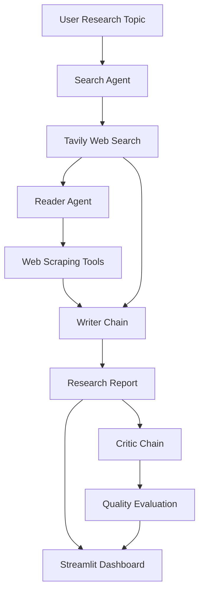

# 🔬 Atlas — Multi-Agent AI Research Studio

An AI-powered research assistant built using **LangChain, Groq, Tavily, Streamlit, and Python**.

This project uses multiple AI components to automate the research workflow — from searching the web and extracting information to generating comprehensive research reports and evaluating their quality.

## 🚀 Features

- **AI-Powered Web Search:** Uses Tavily to discover relevant articles, information, and credible sources.
- **Intelligent Web Scraping:** Extracts readable webpage content using BeautifulSoup, Trafilatura, and Readability.
- **Automated Report Generation:** Generates research reports with an introduction, key findings, conclusion, and references.
- **AI Research Critic:** Evaluates generated reports and provides scores, strengths, and improvement suggestions.
- **Interactive Dashboard:** Modern Streamlit interface with live pipeline progress.
- **Report Downloads:** Export research reports as Markdown files.
- **Multi-Stage AI Workflow:** Coordinates specialized agents and LLM chains.

---

## 🧠 System Architecture

The research pipeline consists of four components:



### 1. Search Agent

Built using LangChain's `create_agent()`.

- Accepts a research topic from the user.
- Uses the Tavily Search API.
- Retrieves relevant information and source URLs.
- Summarizes initial search findings.

### 2. Reader Agent

Uses a custom web scraping tool to extract information.

Three extraction strategies are implemented:

1. **Trafilatura** — Extracts primary article content.
2. **Readability** — Identifies relevant article sections.
3. **BeautifulSoup** — Provides fallback HTML extraction.

The agent reads a selected source and returns important research information.

### 3. Writer Chain

Built using LangChain Expression Language (LCEL).

```python
writer_chain = writer_prompt | llm | StrOutputParser()
```

The Writer Chain generates a structured research report containing:

- Introduction
- Key Findings
- Conclusion
- Sources and References

### 4. Critic Chain

Evaluates the generated research report using an LLM.

```python
critic_chain = critic_prompt | llm | StrOutputParser()
```

The Critic Chain provides:

- Research quality score (1–10)
- Strengths
- Areas for improvement
- Final verdict

**Note:** The Search and Reader components are tool-enabled agents. The Writer and Critic components are LLM chains.

---

## 🛠️ Technology Stack

| Technology | Purpose |
|------------|---------|
| Python | Core programming language |
| LangChain | Agent development and orchestration components |
| LangChain Core | Prompts, tools, and output parsing |
| Groq | LLM inference |
| GPT-OSS 20B | Language model |
| Tavily API | Web search |
| BeautifulSoup | HTML parsing |
| Trafilatura | Article content extraction |
| Readability | Main content extraction |
| Requests | HTTP requests |
| Streamlit | Interactive frontend |
| Python-dotenv | Environment variable management |

---

## 📁 Project Structure

```text
LangChain_MultiAgent_Research_System/
│
├── app.py
├── main.py
├── requirements.txt
├── README.md
├── LICENSE
├── .gitignore
├── .env
│
└── src/
    │
    ├── agents/
    │   └── agents.py
    │
    └── tools/
        └── tools.py
```

**Important:** The `.env` file must remain local and should never be committed to GitHub.

---

## ⚙️ Installation and Setup

### Step 1: Clone the Repository

```bash
git clone https://github.com/psatyask/LangChain_MultiAgent_Research_System.git

cd LangChain_MultiAgent_Research_System
```

### Step 2: Create a Virtual Environment

For Windows:

```bash
python -m venv .venv
```

Activate the environment:

```powershell
.\.venv\Scripts\Activate.ps1
```

For macOS/Linux:

```bash
python3 -m venv .venv
source .venv/bin/activate
```

### Step 3: Install Dependencies

```bash
pip install -r requirements.txt
```

Make sure your dependencies include:

```text
langchain
langchain-core
langchain-community
langchain-groq
streamlit
tavily-python
requests
beautifulsoup4
readability-lxml
trafilatura
python-dotenv
rich
```

### Step 4: Configure Environment Variables

Create a `.env` file in the project root.

```dotenv
GROQ_API_KEY=your_groq_api_key
TAVILY_API_KEY=your_tavily_api_key
```

You can obtain API keys from:

- Groq: https://console.groq.com/
- Tavily: https://tavily.com/

Ensure your `.gitignore` includes:

```gitignore
.env
.env.*
!.env.example
.venv/
__pycache__/
*.pyc
```

### Step 5: Run the Application

```bash
streamlit run app.py
```

Open the local URL provided by Streamlit.

Usually:

```text
http://localhost:8501
```

---

## 🔄 How the Application Works

### Step 1 — Enter a Research Topic

The user provides a topic through the Streamlit interface.

Example:

```text
How are AI agents transforming the healthcare industry?
```

### Step 2 — Web Search

The Search Agent uses Tavily to identify relevant information and URLs.

### Step 3 — Content Extraction

The Reader Agent selects a relevant webpage and invokes the scraping tool.

The extraction pipeline attempts:

```text
Trafilatura
    ↓ Fallback
Readability
    ↓ Fallback
BeautifulSoup
```

### Step 4 — Research Report Generation

The Writer Chain combines the search findings and extracted information to generate a detailed report.

### Step 5 — Critical Evaluation

The Critic Chain evaluates the report and provides structured textual feedback.

### Step 6 — Results Dashboard

The Streamlit interface displays:

- Research Report
- Critic Review
- Search Results
- Extracted Webpage Information
- Download Options

---

## 📊 Example Research Output

**Research Topic:** Applications of Agentic AI

### Introduction

Agentic AI systems combine language models with tools and workflows to perform tasks that require multiple steps.

### Key Findings

1. **Tool Integration:** AI agents can interact with APIs, databases, and external services.

2. **Workflow Automation:** Agents can coordinate information retrieval, analysis, and content generation.

3. **Multi-Agent Collaboration:** Specialized agents can divide complex workflows into smaller responsibilities.

### Conclusion

Agentic AI introduces new opportunities for automating research and information-processing workflows. However, reliability, evaluation, and source verification remain important challenges.

### Sources

Source URLs are included when supplied by the research tools.

*This is an illustrative example, not a verified research result.*

---

## 🎨 Streamlit Dashboard

The application features a modern, dark-themed research interface.

### UI Features

- Responsive dashboard
- Research topic input
- Example research topics
- Live pipeline progress
- Four-stage execution indicators
- Research results organized into tabs
- Critic evaluation panel
- Downloadable reports
- Error handling and execution feedback

---

## ⚠️ Current Limitations

- The research workflow reads a selected webpage rather than automatically extracting every search result.
- Some websites restrict automated scraping.
- JavaScript-rendered webpages may not provide usable content.
- LLM-generated information may contain inaccuracies.
- Generated citations require verification against original sources.
- Research quality depends on the available search results and extracted evidence.
- Public deployment requires additional safeguards for URL validation and network security.

---

## 🔮 Future Enhancements

Planned improvements include:

- Multi-source research and extraction
- LangGraph-based orchestration
- Automated report revision using critic feedback
- Source validation and citation checking
- Research history and persistent storage
- PDF report generation
- RAG integration with vector databases
- Advanced multi-agent evaluation workflows

---

## 📜 License

This project is licensed under the terms provided in the [LICENSE](LICENSE) file.

---

## 👨‍💻 Author

**PSS Krishna Alapati**

AI / ML Engineer | Generative AI | Agentic AI | LangChain

**GitHub:** https://github.com/psatyask

---

⭐ If you find this project useful, consider starring the repository!
